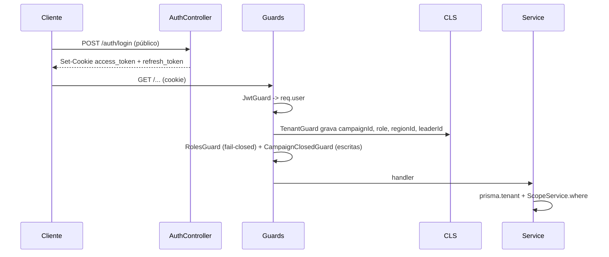
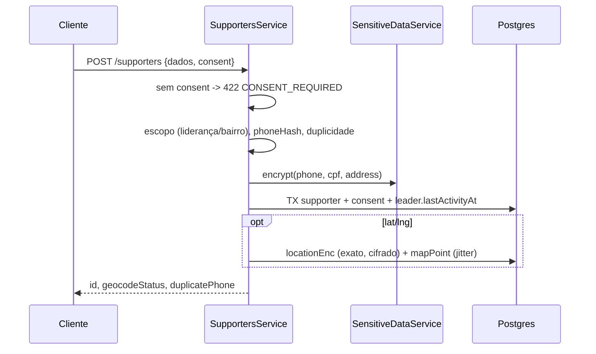

# Codebase Map

> Gerado pelo Cartographer. Último mapeamento: 2026-11-05. Estado: backend F1 (T01–T25) pronto; `web/` com shell T26.

## Visão geral

BaseForte: gestão de lideranças e campanha, apartidário, multi-tenant (tenant = campanha). Eleições municipais, demo Teresina-PI, UI pt-BR.

```mermaid
graph TB
  subgraph Client["web/ Next 14 :3006"]
    WEB[Next.js + MapLibre]
  end
  subgraph API["api/ NestJS :3001 /api/v1"]
    G["Guards globais: Jwt, Tenant, Roles, CampaignClosed"]
    CLS[nestjs-cls]
    MODS[auth, users, regions, leaders, supporters, consent, privacy, map, geocode]
    COMMON["common: SensitiveDataService, GeoRepository, AccessLog, jitter"]
    TEN["tenancy: PrismaService.tenant, ScopeService"]
  end
  PG[("Postgres 16 + PostGIS + pgcrypto :5433")]
  RD[("Redis 7 / BullMQ :6380")]
  NOM[Nominatim 1 req/s]
  SH["packages/shared: Role, Plan, LeaderStatus, PLAN_LIMITS"]
  WEB -->|"rewrite /api/v1 + cookies"| G
  G --> CLS --> MODS
  MODS --> COMMON & TEN
  COMMON & TEN --> PG
  MODS --> RD
  MODS -->|geocode| NOM
  API -.-> SH
```



## Estrutura

```
baseforte/
├── CLAUDE.md · init.md (brief) · TODO.md · Makefile · docker-compose.yml (db, redis; api/web sem Dockerfile)
├── packages/shared/   enums + PLAN_LIMITS (main=dist; rodar `npm run build:shared`)
├── api/               NestJS 10 + Prisma 5
│   ├── prisma/        schema, migrations 0001–0003, seed.ts (senha demo1234)
│   ├── fixtures/      neighborhoods.geojson, voting-places.json (fictícios)
│   ├── src/           common, tenancy, auth, users, regions, leaders, supporters, consent, privacy, map, geocode
│   └── test/          17 e2e (Postgres + Redis no ar)
├── web/               Next 14 App Router, Tailwind (T26)
│   └── src/{app/(auth)/login, app/(app)/layout, middleware.ts, lib/api.ts, components/ui}
├── docs/specs/baseforte-mvp/   analysis (RN/CB/OQ), spec (RF/CA), plan, tasks (T01–T58), diagramas
└── previews/          design-system.html, fluxos.html
```

## Módulos da API

| Módulo | Função | Pontos-chave |
|---|---|---|
| `common/` (global) | config, error filter, PII, geo SQL, access log, paginação | `SensitiveDataService` é o único que (de)cifra (pgcrypto); `jitter.ts` desloca 30–200 m; erro `{statusCode, code, message}`; 400 de validação vira 422 `VALIDATION` |
| `tenancy/` (global) | contexto de tenant e escopo | `prisma.tenant` injeta `campaignId` via CLS (não cobre raw SQL nem `connect`); `ScopeService` monta `where` por papel; `subtreeIds` via CTE recursiva |
| `auth/` | login/refresh/logout/me | cookies `access_token` (15 min, path /) e `refresh_token` (7 d, path /api/v1/auth); 1 slot de refresh por usuário; argon2 |
| `users/` | CRUD de equipe | só CANDIDATO/COORD_GERAL; `PlanLimitService` (403 `PLAN_LIMIT_REACHED`) |
| `regions/` | regiões e bairros | GeoJSON via raw SQL |
| `leaders/` | CRUD, árvore, ranking, mover | `TreeController` registrado antes de `LeadersController` (rota `tree` vs `:id`); status ATIVO ≤14d, FRIO 15–45d, INATIVO; score = 0,6·meta + 0,4·atividade; move rejeita ciclos |
| `supporters/` | cadastro de apoiadores | sem consentimento → 422 `CONSENT_REQUIRED`; telefone com HMAC para duplicidade; PII só no `GET :id` para papéis autorizados |
| `consent/` | re-consentimento, lista de comunicação, `wa.me` | só com consentimento ativo; sem envio em massa |
| `privacy/` | DPO, ROPA (JSON/CSV/PDF), logs, descadastro, encerrar campanha | descadastro idempotente; `CampaignClosedGuard` torna campanha encerrada somente leitura (409) |
| `map/` | camadas GeoJSON e PDF do bairro | lê só `mapPoint` (jitter); `supporterSql()` replica o escopo do `ScopeService` |
| `geocode/` | fila BullMQ + Nominatim | 1 job/s, cache por hash, `attempts: 1` |

### Modelos Prisma
Campaign (global), User, Region, Neighborhood (geom/centroid PostGIS), Leader (árvore `parentId`, `coordinatorId`), Supporter (`*Enc` Bytes, `mapPoint`, `removalToken`), Consent (append-only), AccessLog, RemovalRecord, VotingPlace, GeocodeCache (global). F2/F3 ainda sem modelos.

### Superfície da API (`/api/v1`)
Pública: `health`, `auth/login|refresh`, `public/dpo/:slug`, `public/remove-data/:token`. Autenticada: `auth/logout|me`, `users`, `regions`, `neighborhoods`, `leaders` (+`tree`, `ranking`, `:id/move`), `supporters` (+`consents`, `revoke`), `communication/*`, `map/*`, `neighborhoods/:id/panel|report.pdf`, `geocode`, `privacy/*`.

### Matriz de papéis
| Área | CANDIDATO/COORD_GERAL | COORD_REGIAO | LIDERANCA | AUDITOR |
|---|---|---|---|---|
| Usuários | sim | não | não | não |
| Lideranças (leitura) | todas | sua região | sua subárvore | não |
| Apoiadores e mapa | todos | sua região | sua subárvore | não |
| Logs, ROPA, DPO | sim | não | não | leitura |
| Encerrar campanha, retenção | sim | não | não | não |

## Web (T26)
- Browser chama `/api/v1/*` no mesmo origin; `next.config.mjs` reescreve para `API_URL` (padrão `http://localhost:3001`), então cookies funcionam sem CORS.
- `middleware.ts`: redireciona a `/login` sem cookie `access_token`/`refresh_token` (só presença).
- `(app)/layout.tsx` (server): valida via `/auth/me` com o cookie; banner "não substitui orientação jurídica eleitoral".
- `lib/api.ts`: fetch com credenciais; em 401 tenta `/auth/refresh` e repete; senão vai a `/login`.

## Fluxos

### Login e tenant


### Cadastro de apoiador


### Mapa
`GET /map/heatmap` → só `mapPoint` com `campaignId`, não anonimizado, consentimento ativo e escopo do papel; devolve pontos sem propriedades. Pins de liderança: centróide do bairro + offset determinístico 80–600 m.

### Descadastro
`POST /public/remove-data/:token` ou `POST /supporters/:id/revoke` → já anonimizado: 200 `alreadyRemoved`; senão em TX revoga consentimentos, zera PII e `mapPoint`, grava `RemovalRecord` (HMAC) e log.

## Convenções
- Domínio usa `prisma.tenant`; `prisma` puro só em login, rotas públicas e jobs. SQL raw filtra `campaignId` à mão.
- `create` com FKs escalares. Toda rota autenticada com `@Roles`; pública com `@Public()`. Fora de escopo → 404.
- PII só via `SensitiveDataService`; `@LogAccess` em endpoints de dado pessoal; escrita multi-tabela em `$transaction`.
- Comentários em pt-BR citando RN/CB/CA/OQ. Portas: web 3006, API 3001, Postgres 5433, Redis 6380.

## Armadilhas
1. Env lido no import (`JwtModule`, `BullModule`): `main.ts` não carrega dotenv; exportar variáveis ou `set -a; . ../.env`.
2. `@baseforte/shared` usa `dist`: rodar `npm run build:shared`.
3. Raw SQL ignora a extensão de tenant: `GeoRepository`, `subtreeIds`, `MapService`, `RankingService`, `RegionsService`, `CloseCampaignService`. Manter `MapService.supporterSql()` em sincronia com `ScopeService`.
4. Rate limit em memória (`common/rate-limit.ts`, `RATE_LIMIT=off` nos testes; `trust proxy` = 1); geocode sem retry.
5. Link de descadastro: `POST /supporters` devolve `removalUrl` e `GET /supporters/:id/removal-link` o reemite (URL base em `WEB_URL`).
6. `statusWhere` aproxima `computeStatus` (cortes 15/46 dias).
7. Um slot de refresh por usuário: login em outro dispositivo invalida o anterior.
8. `dotenv` não declarado em `package.json`; ESLint sem config (T35); sem Dockerfiles de api/web.

## Guia de navegação
- **Endpoint novo**: `api/src/<mod>/{controller,service,dto,module}.ts`, registrar em `app.module.ts`, `@Roles`, `prisma.tenant` + `ScopeService`, e2e em `api/test/`.
- **Modelo tenant novo**: `schema.prisma` com `campaignId` + migration nova (nunca editar aplicada); geometria via `Unsupported` + SQL com GiST.
- **Papel novo / escopo**: `packages/shared`, enum Prisma + migration, `scope.service.ts`, `map.service.ts#supporterSql`, `@Roles`.
- **Campo sensível novo**: `Bytes xxxEnc` via `SensitiveDataService`; atualizar `ropa.service.ts`, `removal.service.ts`, `close-campaign.service.ts`.
- **Raio do jitter**: `common/jitter.ts`; pins: `map.service.ts#leaders`.
- **Auth/cookies**: `auth/auth.controller.ts`, `auth.service.ts`, `jwt.guard.ts`.
- **Tela nova**: `web/src/app/(app)/<rota>/page.tsx`; dados via `api()` de `web/src/lib/api.ts`.

## Rodar local
```
cp .env.example .env
docker compose up -d db redis
npm install && npm run build:shared
cd api && npx prisma migrate deploy && npx prisma db seed && npm run dev
cd web && npm run dev
```
Logins do seed: `candidato@exemplo.test`, `lideranca01@exemplo.test` (senha `demo1234`).
