# Fluxogramas e diagramas de uso e regras

Fonte única dos diagramas (Mermaid). O preview visual é gerado em `previews/fluxos.html`.

## Arquitetura
Quem fala com quem. A API é a única que toca o banco; o mapa nunca recebe dado pessoal exato.

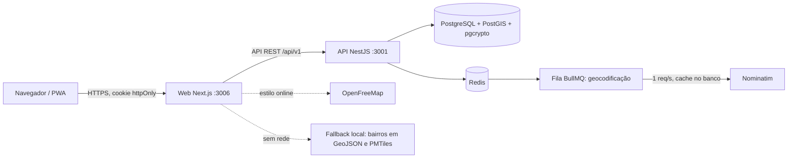

## Jornada de uso por papel
O que cada papel enxerga ao entrar. O fluxo do e2e é: login, mapa, filtrar bairro, abrir liderança, registrar visita.

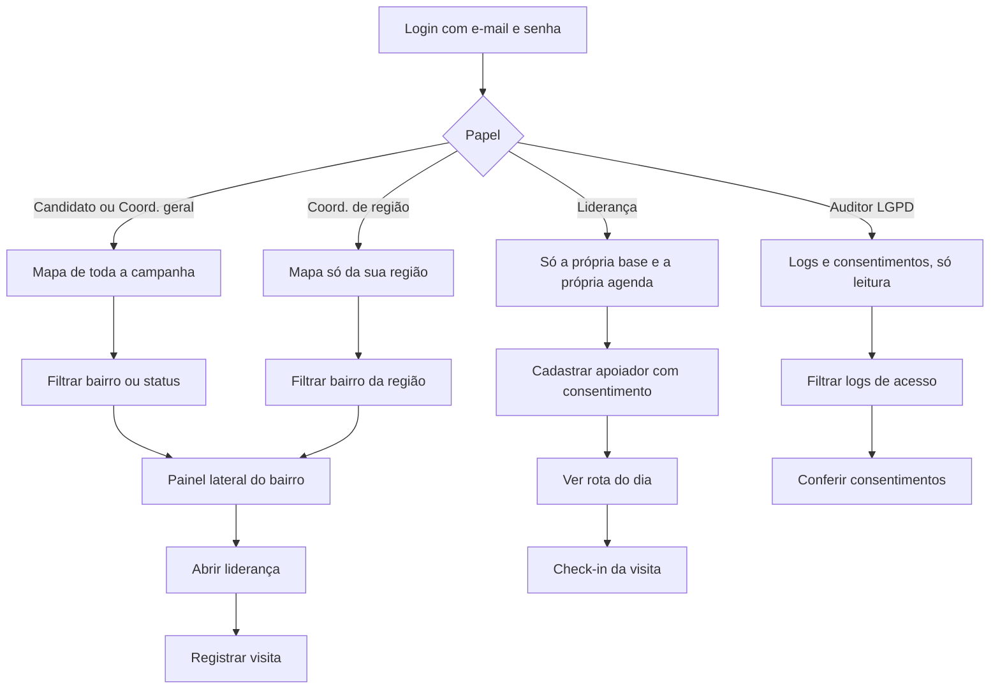

## Cadastro de apoiador
Sem consentimento não há cadastro. A posição vai para o mapa sempre com deslocamento.

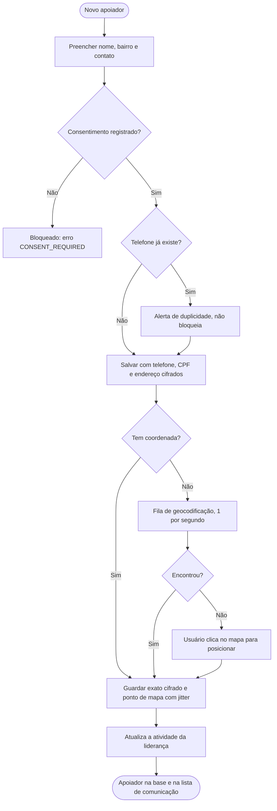

## Descadastro do titular
Um clique, sem login. Dados pessoais somem; sobra só um registro mínimo como prova.

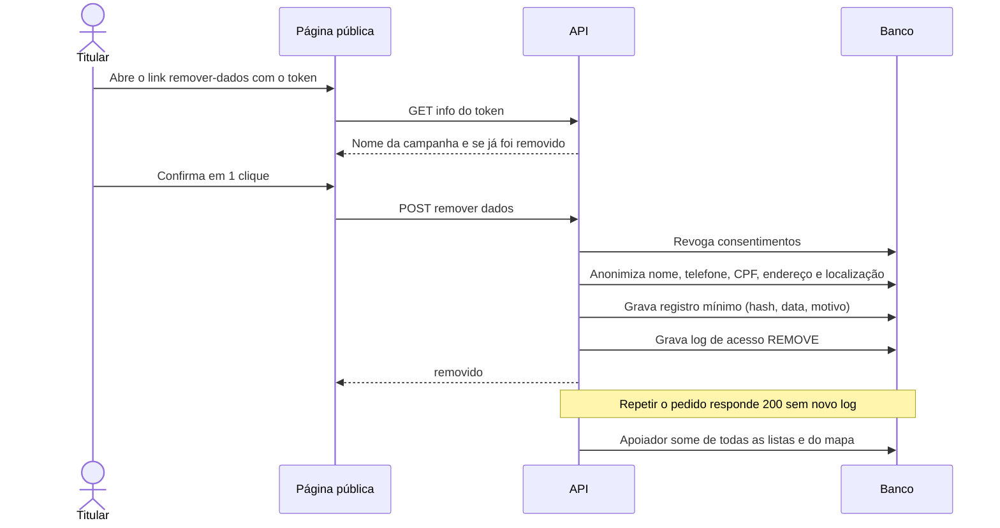

## Regras de acesso a cada requisição
A ordem importa: cada etapa pode barrar. Papel sem permissão na rota recebe 403; registro fora do escopo recebe 404.

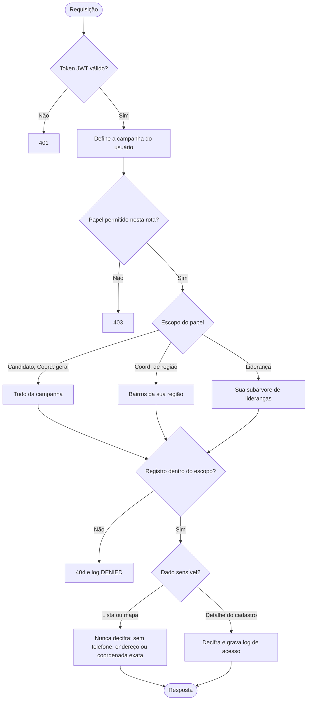

## Privacidade da posição no mapa
O mapa lê só o ponto deslocado. A coordenada exata fica cifrada e só aparece no detalhe.

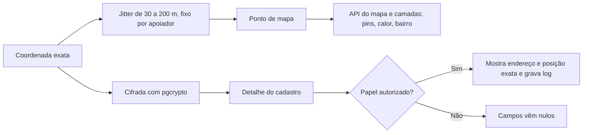

## Status da liderança
Calculado pela última atividade. O coordenador pode fixar o status à mão.

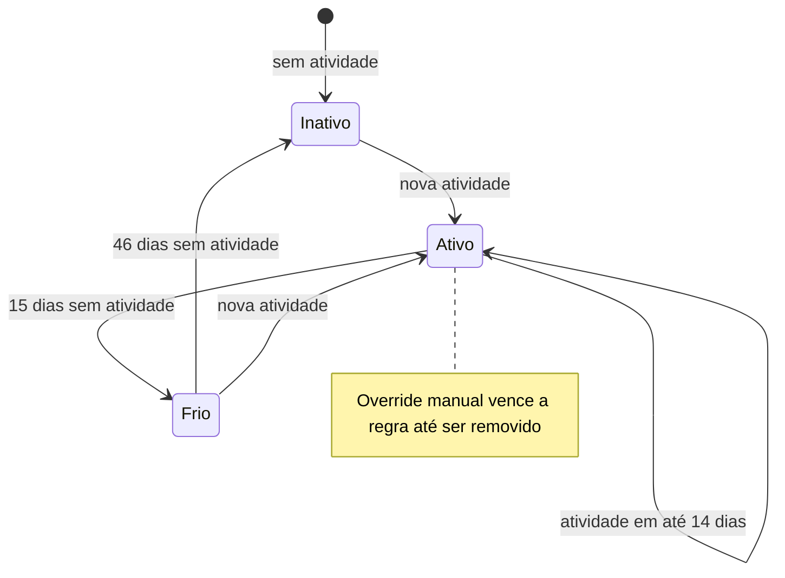

## Mover liderança na árvore
Arrastar leva junto toda a subárvore. Ciclos e destinos fora do escopo são barrados.

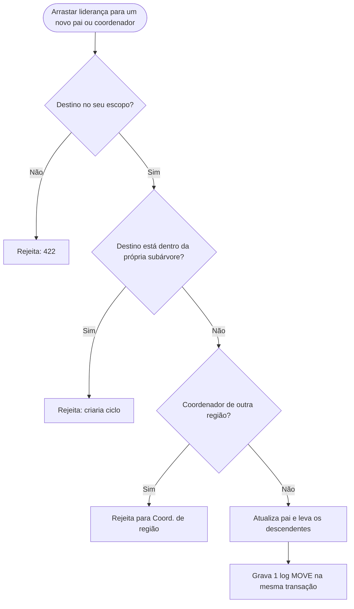

## Ciclo da campanha
Mandato muda rótulos e módulos. Encerrar é irreversível e aplica a política de retenção.

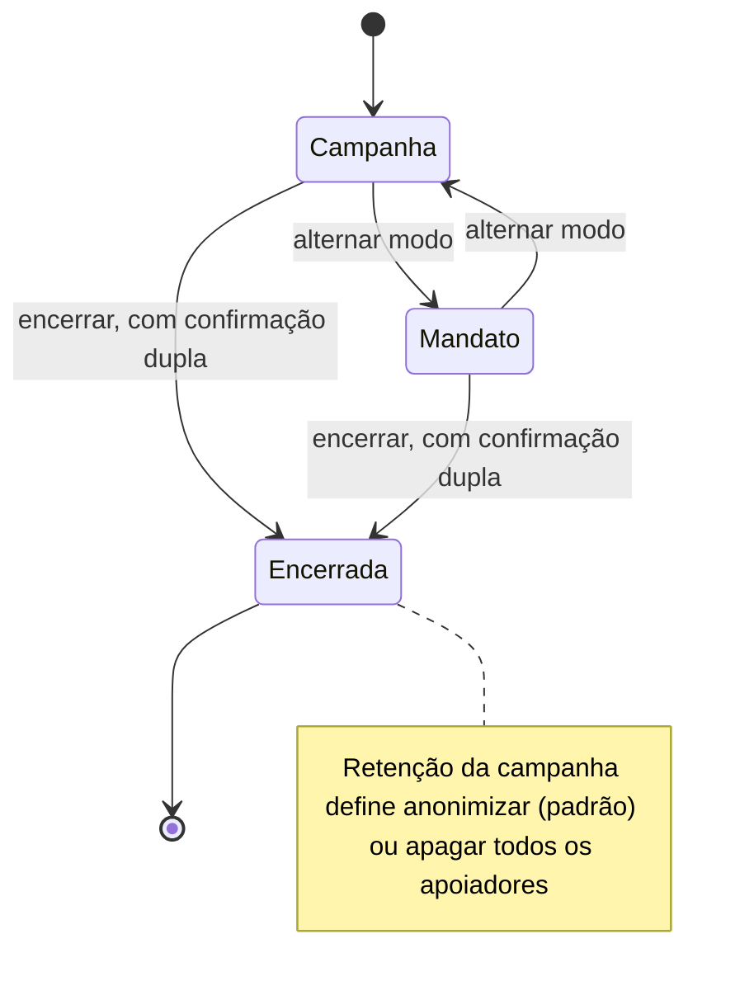

## Demanda da comunidade
Só vira resolvida com o retorno dado ao cidadão registrado.

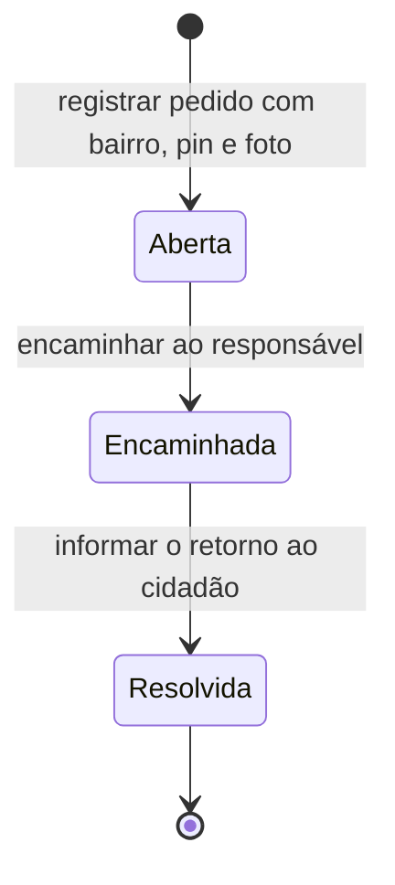

## Comunicação com consentimento
Nada de disparo em massa: só link individual, enviado manualmente pelo usuário.

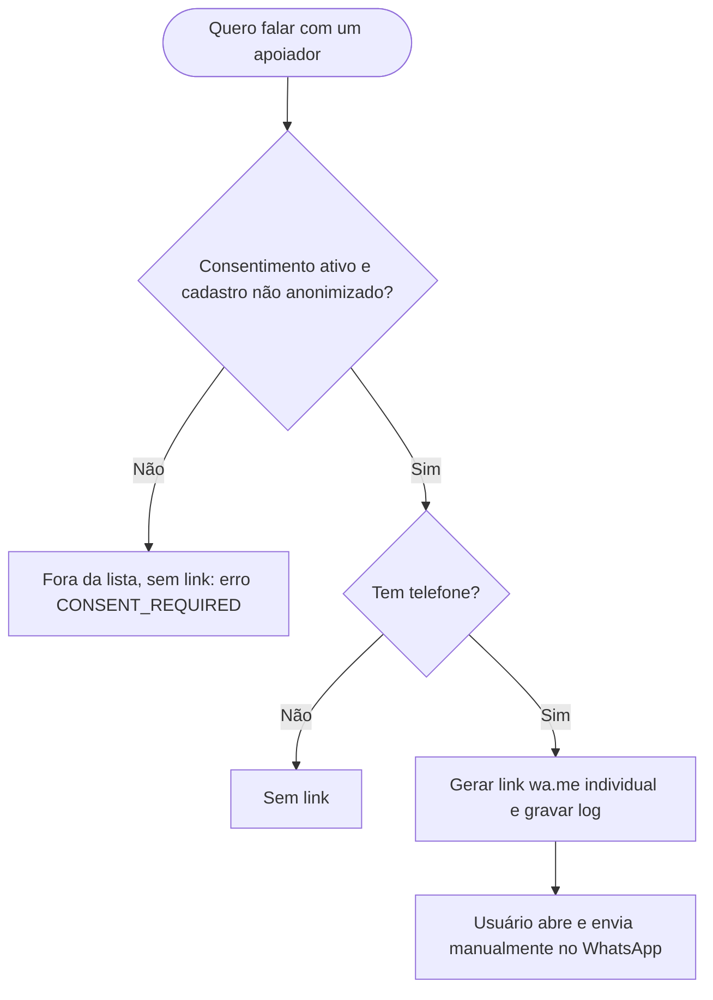
